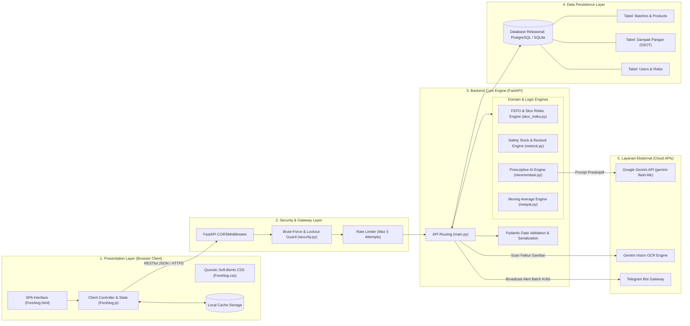
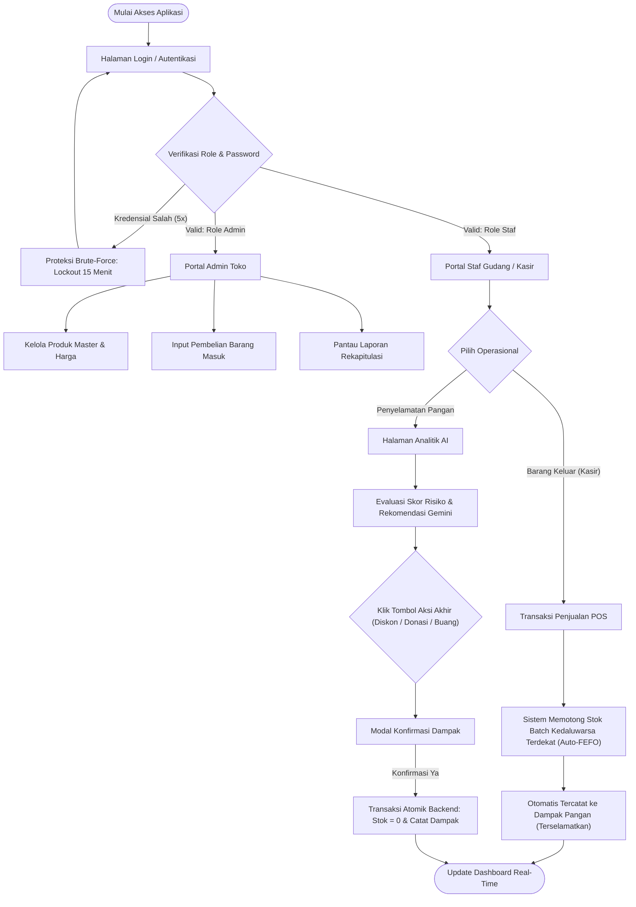

# FreshLog — Sistem Manajemen Inventori FEFO, Penyelamatan Pangan, & Analitik AI untuk UMKM

<p align="center">
  
</p>

<p align="center">
  <strong>Solusi Inventori Cerdas Berbasis Rotasi FEFO (First Expired, First Out), Preskripsi AI, dan Mitigasi Limbah Makanan untuk Pelaku Usaha Ritel & Makanan</strong>
</p>

<p align="center">
  
  
  
  
</p>

---

## 👥 Informasi Tim & Kompetisi

- **Nama Tim**: Neutrixel
- **Anggota Tim**:
  1. **Razi Fakhruddin Naufal**
  2. **Hilman Ismail**
- **Kategori Lomba**: Lokal MSME & Creative Economy
- **Subkategori**: Web Application
- **Nama Aplikasi**: **FreshLog**

---

## 📌 Ringkasan Solusi & Latar Belakang Masalah

### 1. Masalah yang Diangkat
Pelaku UMKM di sektor ritel bahan pangan, bakery, produk susu (*dairy*), dan makanan olahan sering menghadapi tantangan berat dalam pengelolaan rantai pasok dan inventaris harian:
1. **Tingginya Limbah Pangan (*Food Waste*)**: Barang dagangan menumpuk di rak belakang dan terlanjur kedaluwarsa sebelum terjual karena sistem rotasi barang masih mengandalkan intuisi manual atau FIFO biasa.
2. **Kerugian Finansial Tersembunyi**: Kerugian akibat barang busuk atau retur kedaluwarsa memangkas marjin keuntungan UMKM hingga 15–25% per bulan.
3. **Pencatatan Konvensional & Ketiadaan Proyeksi**: Banyak UMKM masih mencatat stok secara manual pada buku kertas atau spreadsheet sederhana, tanpa visibilitas sisa hari simpan (*shelf life*) dan prediksi kebutuhan belanja stok ulang (*restock*).

### 2. Solusi yang Dihadirkan oleh FreshLog
**FreshLog** menghadirkan ekosistem manajemen inventaris ritel modern berbasis web yang mengintegrasikan:
- **Rotasi Otomatis FEFO (*First Expired, First Out*)**: Transaksi kasir POS memotong stok batch yang mendekati kedaluwarsa secara otomatis tanpa kasir perlu mengingat tanggal tiap kemasan.
- **Analitik Skor Risiko Dinamis (0–100)**: Memperhitungkan sisa hari kedaluwarsa terhadap kecepatan penjualan aktual 14 hari terakhir.
- **Rekomendasi Preskriptif AI (Google Gemini Flash-Lite)**: Memberikan saran bisnis yang dapat langsung dieksekusi (diskon bertahap, bundling produk lambat, donasi sosial, atau pengomposan).
- **Dasbor Dampak Penyelamatan Pangan (*Food Rescue Impact*)**: Menghitung secara transparan nominal rupiah dan porsi makanan yang terselamatkan vs terbuang.

### 3. Target Pengguna
- Toko kelontong modern & minimarket lokal.
- Toko bahan kue, roti (*bakery*), dan produk susu (*dairy*).
- Pengusaha *frozen food*, daging segar, buah, dan sayuran.
- Komunitas bank makanan dan dapur UMKM katering.

---

## 🚀 Daftar Fitur Utama yang Telah Diimplementasikan

| Modul Fitur | Deskripsi Fungsionalitas |
| :--- | :--- |
| **Autentikasi & RBAC** | Pembagian hak akses antara **Admin Toko** (akses penuh) dan **Staf Toko/Kasir** (operasional harian), dilengkapi proteksi **Brute-Force Lockout 15 Menit** (maks. 5 percobaan gagal). |
| **Dashboard & Dampak** | Tampilan *Quixotic Soft-Bento Grid* metrik KPI, tren omzet, status stok kritis H-7, serta kartu ringkasan dampak pangan (Terselamatkan vs Kerugian). |
| **Master Produk & FEFO** | Kelola master komoditas, SKU/Barcode, harga beli/jual standar, serta urutan batch terurut dari kedaluwarsa terdekat. Tombol penambahan master produk dikhususkan untuk role Admin. |
| **Kasir POS Otomatis FEFO** | Pemindaian barcode produk, keranjang belanja interaktif, kalkulator kembalian, pemotongan stok otomatis batch kedaluwarsa terdekat, serta pencetakan struk nota belanja. |
| **Pembelian (Barang Masuk)** | Form pencatatan barang masuk dari pemasok dengan validasi hak akses **khusus Admin** (tersembunyi bagi role Staf), pencatatan nomor PO, harga beli, dan estimasi waktu sampai. |
| **Scanner Barcode Hybrid** | Pemindaian barcode kemasan menggunakan kamera (library Quagga2) maupun input manual Barcode/SKU dengan responsivitas tinggi. |
| **Smart Input (OCR & Voice)** | Pindai nota/faktur fisik pemasok menggunakan **Gemini Vision OCR** dan input transaksi kasir cepat via pengenalan suara (**Web Speech API**). |
| **Analitik Preskriptif AI** | Evaluasi risiko batch stok (Hijau/Kuning/Merah) dipadukan dengan rekomendasi model **Google Gemini Flash-Lite** untuk strategi diskon dinamis, donasi, atau pemusnahan. |
| **Aksi Akhir Batch Atomik** | Eksekusi tombol tindakan penyelamatan pangan (*Terjual Diskon / Donasi / Buang*) dengan validasi modal konfirmasi yang langsung menyinkronkan status ke tabel dampak pangan secara idempoten. |
| **Laporan Rekapitulasi** | Analisis performa multi-periode (Harian, Bulanan, Tahunan), filter per produk, metrik penyelamatan pangan terpadu, dan grafik tren interaktif Chart.js. |
| **Notifikasi Bot Telegram** | Peringatan otomatis real-time ke akun/grup Telegram manajer toko saat terdeteksi batch kritis mendekati expired atau stok menipis. |
| **Pengaturan & Audit Trail** | Pengaturan profil pengguna, batas ambang (*threshold*) kedaluwarsa per produk, kustomisasi satuan & kategori, serta pencatatan audit log aktivitas seluruh pengguna. |

---

## 🛠️ Arsitektur Teknologi & Dependensi

### 1. Frontend
- **Arsitektur**: Single Page Application (SPA) responsif tanpa reload halaman.
- **Bahasa & Standar**: Vanilla JavaScript (ES6+), HTML5 Semantic, CSS3 Modern (*Custom Properties*, Grid Bento, Flexbox).
- **Komponen Visual**: *Quixotic Soft-Bento Design System* bernuansa Sage Green, Charcoal Slate, dan aksen Emerald.
- **Pustaka Pihak Ketiga**:
  - [Chart.js](https://www.chartjs.org/) (v4.4.1) — Visualisasi grafik tren penjualan, pembelian, dan dampak pangan.
  - [Quagga2](https://github.com/ericblade/quagga2) (v1.8.4) — Barcode scanner kamera berbasis web.

### 2. Backend Engine
- **Framework**: [FastAPI](https://fastapi.tiangolo.com/) (Python 3.10+) — RESTful API asinkron berperforma tinggi.
- **Server ASGI**: [Uvicorn](https://www.uvicorn.org/) (v0.34.0+).
- **Validasi Data**: [Pydantic v2](https://docs.pydantic.dev/) — Validasi tipe data dan skema request/response JSON secara ketat.
- **HTTP Client**: [Requests](https://requests.readthedocs.io/) — Komunikasi eksternal ke Telegram API dan Google Gemini API.

### 3. Persistensi Data
- **Relasional Backend**: SQLite / PostgreSQL dengan transaksi ACID (*Single Source of Truth* untuk dampak pangan dan riwayat transaksi).
- **State Client**: LocalStorage synchronizer untuk caching lokal dan mode operasional saat offline.

### 4. Layanan Pihak Ketiga & Cloud APIs
- **Google Gemini API** (`gemini-flash-lite-latest` & Gemini Vision OCR) — Mesin pemrosesan bahasa alami untuk rekomendasi bisnis dan ekstraksi faktur fisik.
- **Telegram Bot API** — Pengiriman alert notifikasi stok kedaluwarsa.
- **UI-Avatars API** — Pembangkit avatar dinamis berdasarkan nama pengguna.

---

## 🏗️ Diagram Arsitektur Sistem & Alur Data

### 1. Arsitektur Berlapis (Layered Architecture)



### 2. User Flow Utama (Alur FEFO & Mitigasi Risiko)



> **Dokumentasi Visual Lengkap**: Seluruh diagram cetak biru arsitektur resolusi tinggi tersedia pada direktori [`docs/images/`](docs/images/) dan berkas ringkasan [`docs/Cetak_Biru_Sistem_FreshLog.md`](docs/Cetak_Biru_Sistem_FreshLog.md).

---

## 💻 Panduan Instalasi & Menjalankan Aplikasi

### 1. Prasyarat Sistem
- **Python**: Versi `3.10` atau yang lebih baru.
- **Git**: Terpasang pada sistem operasi.
- **Web Browser**: Google Chrome, Mozilla Firefox, Microsoft Edge, atau Safari versi terkini.

### 2. Kloning Repositori
```bash
git clone https://github.com/razifakhruddin9/freshlog.git
cd freshlog
```

### 3. Pembuatan Virtual Environment
- **Linux / macOS**:
  ```bash
  python3 -m venv .venv
  source .venv/bin/activate
  ```
- **Windows (Command Prompt / PowerShell)**:
  ```powershell
  python -m venv .venv
  .venv\Scripts\activate
  ```

### 4. Instalasi Dependensi Python
```bash
pip install -r requirements.txt
```

### 5. Konfigurasi Variabel Lingkungan (`.env`)
Salin file template `.env.example` menjadi file `.env`:
- **Linux / macOS**:
  ```bash
  cp .env.example .env
  ```
- **Windows**:
  ```powershell
  copy .env.example .env
  ```

Buka file `.env` dan masukkan kredensial API Anda:
```env
# Kunci API Google Gemini (dapatkan dari Google AI Studio: https://aistudio.google.com/)
GEMINI_API_KEY=AIzaSy...

# Token Bot Telegram (dapatkan dari @BotFather: https://t.me/BotFather)
TELEGRAM_BOT_TOKEN=1234567890:ABCdef...

# Konfigurasi Server (Opsional)
PORT=8000
HOST=127.0.0.1
```

> ⚠️ **PENTING**: File `.env` bersifat rahasia dan sudah terdaftar di `.gitignore`. Jangan pernah mengunggah file `.env` ke repositori publik.

### 6. Menjalankan Server Backend FastAPI
Jalankan server aplikasi menggunakan Uvicorn:
```bash
uvicorn main:app --reload --port 8000
```
- Server backend akan aktif di: `http://127.0.0.1:8000`
- Dokumentasi interaktif Swagger API docs dapat diakses di: `http://127.0.0.1:8000/docs`

### 7. Membuka Antarmuka Frontend
Buka browser dan navigasikan ke alamat:
```
http://127.0.0.1:8000/
```
*(Frontend dilayani langsung secara otomatis melalui mounting static files FastAPI).*

---

## 🔑 Akun Demonstrasi (Demo Credentials)

Sistem FreshLog dilengkapi dengan akun simulasi siap pakai untuk mempermudah evaluasi fitur:

| Role Pengguna | Username | Password | Hak Akses Utama |
| :--- | :--- | :--- | :--- |
| **Admin Toko** | `admin` | `123` | Akses penuh ke seluruh menu: Kelola Produk Master, Pembelian Barang Masuk, Analitik Finansial, Konfigurasi Bot Telegram, Manajemen Akun Pengguna, dan Audit Log. |
| **Staf Gudang 1** | `staf1` | `123` | Operasional kasir POS FEFO, input stok batch masuk, aksi penyelamatan pangan analitik AI. *(Menu Pembelian Barang Masuk disembunyikan)*. |
| **Staf Gudang 2** | `staf2` | `123` | Operasional kasir shift sore/malam, monitoring kedaluwarsa batch, eksekusi tombol aksi akhir. |

> 🔒 **Uji Coba Proteksi Brute-Force**: Jika kata sandi dimasukkan salah sebanyak 5 kali berturut-turut, sistem akan secara otomatis mengunci login (*lockout*) selama 15 menit dengan penghitung waktu mundur (*countdown timer*) real-time.

---

## 🤖 Dokumentasi Penggunaan Kecerdasan Buatan (AI)

FreshLog menerapkan AI secara pragmatis dan efisien untuk membantu pengambilan keputusan operasional ritel UMKM:

### 1. Google Gemini Flash-Lite (`gemini-flash-lite-latest`)
- **Fungsi**: Menganalisis batch yang berstatus risiko tinggi (Merah / Kuning) dan memformulasikan rekomendasi preskriptif dalam bahasa Indonesia yang ringkas dan aplikatif bagi pelaku usaha.
- **Parameter Input**: Nama komoditas, sisa kuantitas stok, sisa hari kedaluwarsa, rata-rata penjualan harian, harga beli modal, dan harga jual konsumen.
- **Output AI**: Kategori rekomendasi (`DISKON`, `DONASI`, `BUANG`), besaran persentase diskon dinamis (misal: Diskon 30% pada H-3, Diskon 60% pada H-1), estimasi potensi rupiah yang terselamatkan, serta alasan teknis singkat.
- **Graceful Fallback**: Jika kuota API habis atau server offline, sistem secara otomatis beralih (*seamless fallback*) ke *Heuristic Deterministic Decision Tree Engine* lokal tanpa memutus alur kerja pengguna.

### 2. Gemini Vision OCR (Ekstraksi Faktur / Nota Pembelian)
- **Fungsi**: Membaca foto atau tangkapan kamera nota pembelian pemasok.
- **Proses**: Mengubah gambar faktur menjadi data terstruktur JSON (nama barang, jumlah qty, tanggal jatuh tempo / kedaluwarsa, dan harga modal) sehingga staf gudang tidak perlu mengetik satu per satu.

### 3. Web Speech API (Pencatatan Berbasis Suara)
- **Fungsi**: Memungkinkan kasir dan staf gudang mengucapkan perintah transaksi cepat, misalnya *"Jual 2 botol susu ultra"* atau *"Masuk 10 roti tawar"*, yang langsung diubah menjadi entri transaksi siap verifikasi.

---

## 📜 Atribusi Template, Pustaka, & Pihak Ketiga

Seluruh pustaka, aset, dan kode pihak ketiga yang digunakan dalam pengembangan FreshLog digunakan dengan mematuhi lisensi resmi masing-masing:

1. **Framework & Pustaka Backend**:
   - [FastAPI](https://github.com/tiangolo/fastapi) (MIT License) oleh Sebastián Ramírez.
   - [Uvicorn](https://github.com/encode/uvicorn) (BSD-3-Clause License) oleh Encode OSS.
   - [Pydantic](https://github.com/pydantic/pydantic) (MIT License) oleh Samuel Colvin dkk.
   - [Requests](https://github.com/psf/requests) (Apache 2.0 License) oleh Kenneth Reitz dkk.

2. **Pustaka Antarmuka & Visualisasi**:
   - [Chart.js](https://github.com/chartjs/Chart.js) (MIT License) oleh Chart.js Contributors.
   - [Quagga2](https://github.com/ericblade/quagga2) (MIT License) oleh Eric Blade dkk.
   - [Inter Font & Plus Jakarta Sans](https://fonts.google.com/) (SIL Open Font License 1.1).
   - [Lucide / Feather Icons](https://lucide.dev/) (ISC / MIT License) untuk vektor modern SVG icon.

3. **Layanan Eksternal**:
   - [Google Gemini API](https://ai.google.dev/) oleh Google DeepMind / Google Cloud.
   - [Telegram Bot API](https://core.telegram.org/bots/api) oleh Telegram Messenger Inc.
   - [UI Avatars](https://ui-avatars.com/) untuk avatar inisial nama pengguna.

4. **Data Pengujian**:
   - Seluruh data inventaris, katalog produk, riwayat penjualan, dan transaksi yang disertakan dalam repositori ini merupakan **data sintetis/simulasi** untuk tujuan demonstrasi sistem.

---

<p align="center">
  Dibuat dengan ❤️ dan dedikasi oleh <strong>Tim Neutrixel</strong><br>
  <em>Memberdayakan UMKM Indonesia Menuju Nol Limbah Pangan & Efisiensi Ritel Maksimal</em>
</p>
