# Cetak Biru Arsitektur & Skema Kerja Sistem FreshLog
> **Sistem Manajemen Inventori, Rotasi FEFO, dan Penyelamatan Pangan UMKM**  
> Tanggal: 13 November 2026 | Status: Dokumen Desain Teknis (Architecture Blueprint)

---

## 1. User Flow Utama

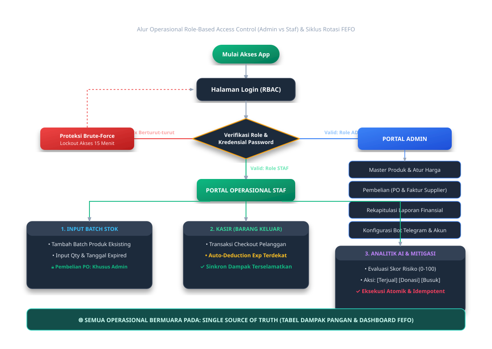

Diagram alur (*flowchart*) berikut menggambarkan perjalanan pengguna dari proses autentikasi (berbasis hak akses Admin vs Staf) hingga eksekusi operasional kasir, manajemen stok FEFO, dan mitigasi risiko kedaluwarsa.

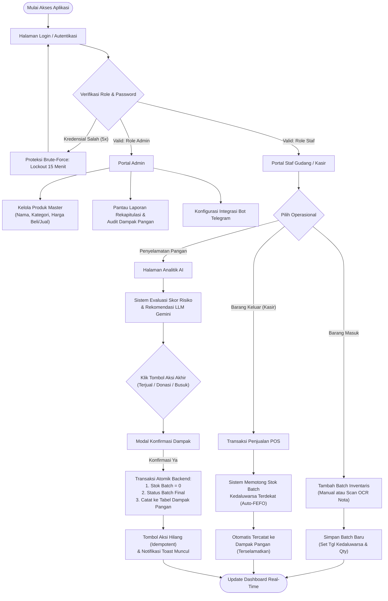

> **Penjelasan Singkat**: Alur di atas memisahkan wewenang antara Admin (penetapan harga master & analitik finansial) dan Staf (operasional kasir & gudang). Seluruh alur barang keluar terintegrasi langsung dengan logika rotasi FEFO (*First Expired, First Out*) dan bermuara pada pencatatan otomatis metrik penyelamatan pangan.

---

## 2. Sitemap Sistem FreshLog

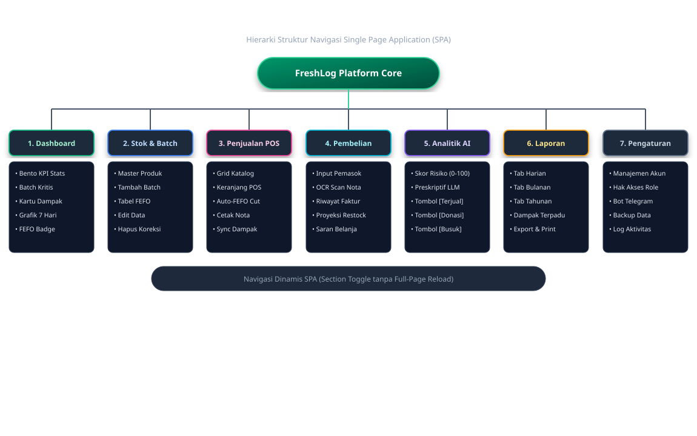

Struktur navigasi hierarkis *Single Page Application* (SPA) sistem FreshLog:

```mermaid
flowchart TD
    App["FreshLog SaaS Platform"]
    
    %% Level 1
    App --> NavDash["1. Dashboard & Dampak"]
    App --> NavStok["2. Stok & Batch"]
    App --> NavKasir["3. Penjualan (Kasir POS)"]
    App --> NavBeli["4. Pembelian (Stok Masuk)"]
    App --> NavAI["5. Analitik AI"]
    App --> NavLapor["6. Laporan Rekapitulasi"]
    App --> NavSet["7. Pengaturan Sistem"]
    
    %% Level 2 - Dashboard
    NavDash --> D1["KPI Bento Metrics (Omzet, Profit, Kedaluwarsa)"]
    NavDash --> D2["Daftar Batch Kritis (H-7 s/d Expired)"]
    NavDash --> D3["Kartu Dampak Pangan (Swiss-Bento Design)"]
    NavDash --> D4["Grafik Tren Pembelian vs Penjualan (7 Hari)"]
    
    %% Level 2 - Stok & Batch
    NavStok --> S1["Master Produk Master (Role Admin)"]
    NavStok --> S2["Form Tambah Batch Baru (Role Staf/Admin)"]
    NavStok --> S3["Tabel Inventaris FEFO (Urutan Kedaluwarsa)"]
    NavStok --> S4["Aksi Edit & Hapus Koreksi Batch"]
    
    %% Level 2 - Penjualan
    NavKasir --> K1["Katalog Produk & Grid Pencarian"]
    NavKasir --> K2["Keranjang Belanja & Kalkulator Kembalian"]
    NavKasir --> K3["Cetak Nota Struk Belanja"]
    
    %% Level 2 - Pembelian
    NavBeli --> P1["Form Input Batch Pemasok"]
    NavBeli --> P2["Pindai Faktur Fisik via AI OCR Vision"]
    NavBeli --> P3["Tabel Proyeksi Kebutuhan Restock AI"]
    
    %% Level 2 - Analitik AI
    NavAI --> A1["Monitoring Skor Risiko (0-100)"]
    NavAI --> A2["Rekomendasi Preskriptif Gemini (Diskon/Donasi/Buang)"]
    NavAI --> A3["Tombol Aksi Akhir Batch & Konfirmasi Modal"]
    
    %% Level 2 - Laporan
    NavLapor --> L1["Sub-tab: Laporan Harian, Bulanan, Tahunan"]
    NavLapor --> L2["Kartu Terpadu Dampak Pangan (Terselamatkan vs Kerugian)"]
    NavLapor --> L3["Filter Multi-Kriteria (Periode & Produk Master)"]
    NavLapor --> L4["Grafik Komparasi Volume & Ekspor Cetak"]
    
    %% Level 2 - Pengaturan
    NavSet --> ST1["Manajemen Akun & Role (Admin / Staf)"]
    NavSet --> ST2["Konfigurasi Notifikasi Bot Telegram"]
    NavSet --> ST3["Audit Log Riwayat Aktivitas"]
```

> **Penjelasan Singkat**: Sitemap dirancang modular dengan 7 menu utama yang saling terhubung secara reaktif tanpa perlu me-reload halaman browser (*Single Page App*).

---

## 3. Arsitektur Sistem (Layered Architecture)

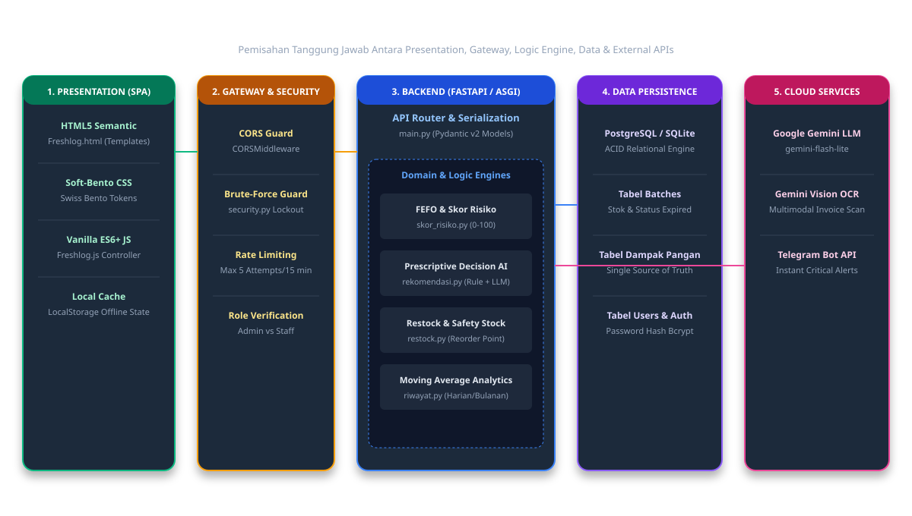

Diagram blok arsitektur teknis dari Presentation Layer hingga Cloud Third-Party Service:

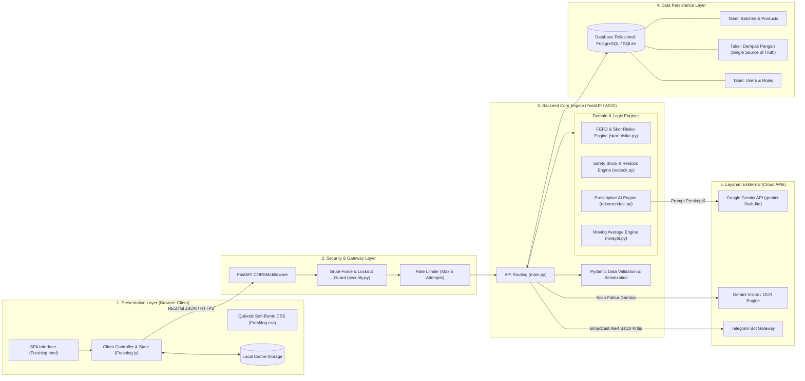

> **Penjelasan Singkat**: Arsitektur memisahkan logika antarmuka, gateway keamanan, domain perhitungan matematis deterministik, dan orkestrasi model AI pihak ketiga. Jika API eksternal (Gemini) tidak dapat dijangkau, Decision Engine otomatis beralih (*graceful fallback*) ke Heuristic Rule Engine lokal.

---

## 4. Entity-Relationship Diagram (ERD Database)

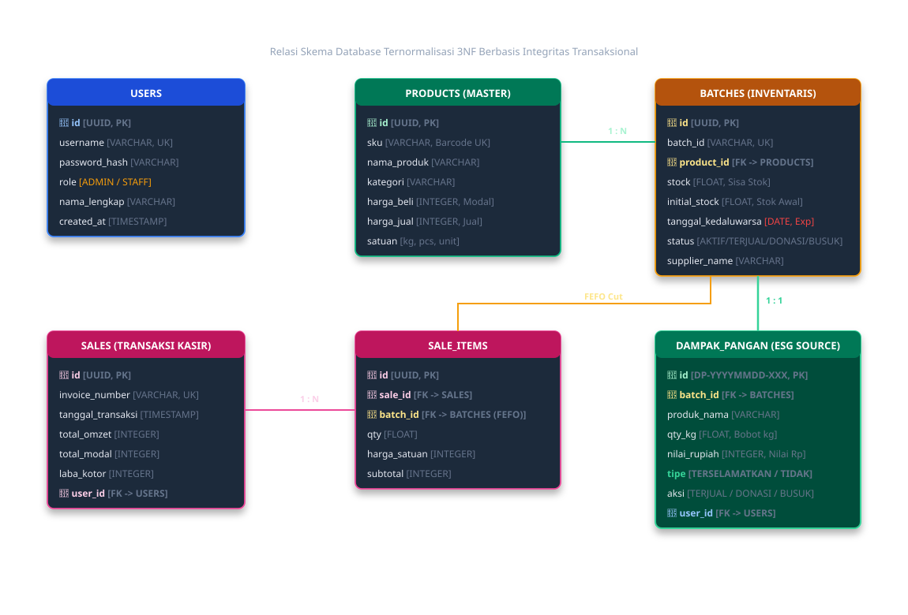

Skema database ternormalisasi (3NF) yang menjamin integritas transaksi dan keterlacakan batch:

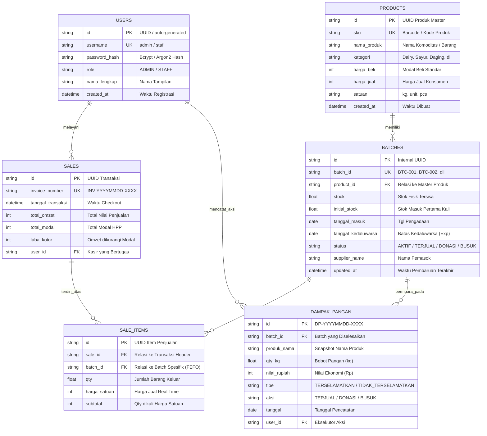

> **Penjelasan Singkat**: Entitas `DAMPAK_PANGAN` bertindak sebagai *Single Source of Truth* untuk semua metrik keberlanjutan pangan (ESG) yang berasal dari dua jalur transaksi: kasir reguler (`TERJUAL`) dan aksi akhir mitigasi risiko (`TERJUAL`, `DONASI`, atau `BUSUK`).

---

## 5. Sequence Diagram: Alur Eksekusi Aksi Akhir Batch (Penyelamatan Pangan)

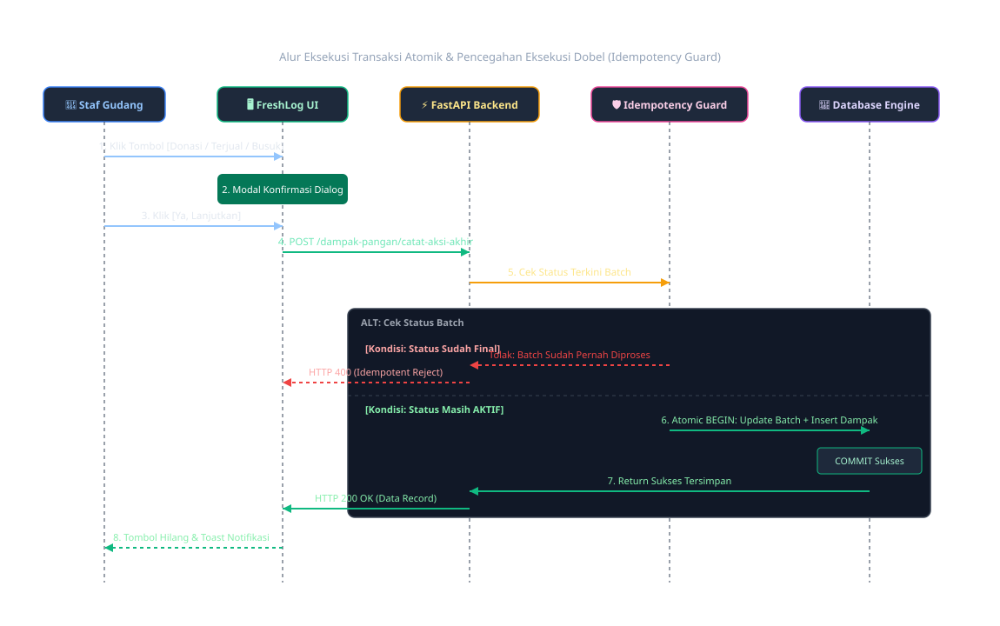

Diagram interaksi berikut mengilustrasikan penanganan transaksi atomik dan pencegahan eksekusi ganda (*idempotency check*) saat staf mengklik tombol aksi akhir di halaman Analitik AI:

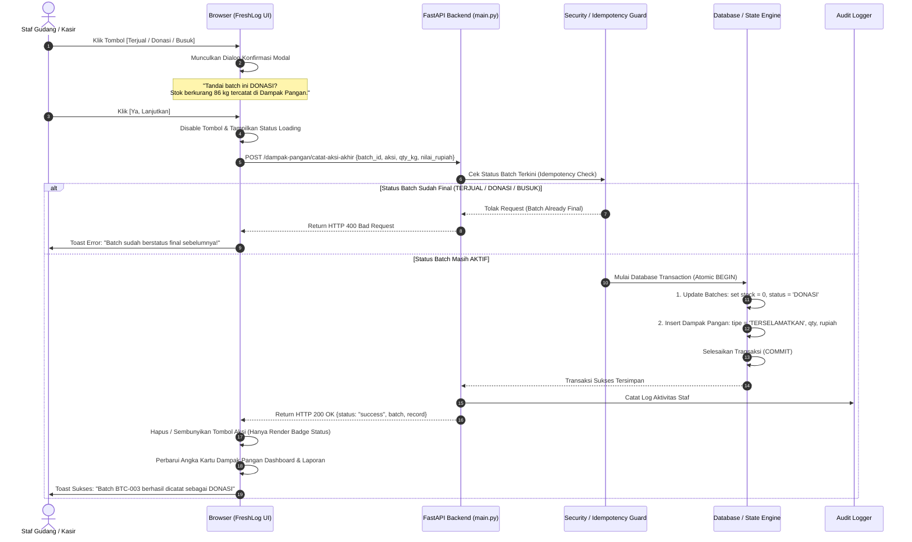

> **Penjelasan Singkat**: Diagram di atas menjamin aturan bisnis: satu batch hanya boleh memiliki satu kali aksi final. Backend memvalidasi idempotensi sebelum menulis database, mencegah anomali stok minus atau pencatatan ganda pada metrik dampak pangan.

---

## 6. Topologi Infrastruktur Deployment

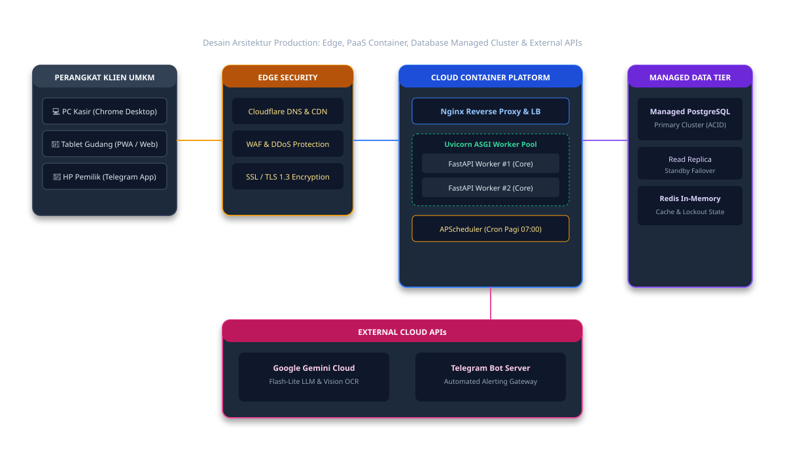

Diagram topologi infrastruktur komputasi untuk lingkungan *production*:

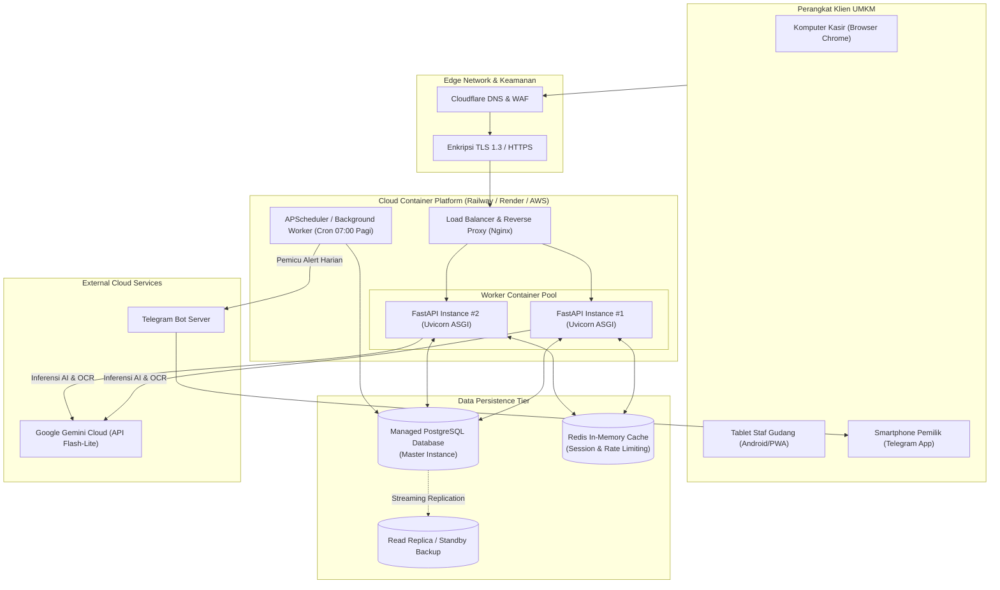

> **Penjelasan Singkat**: Seluruh trafik browser klien dilindungi oleh Cloudflare Edge (WAF & SSL) sebelum dialihkan ke Load Balancer Nginx. Di backend, multi-worker Uvicorn ASGI melayani request secara paralel dan terhubung ke kluster database PostgreSQL serta Redis untuk manajemen beban tinggi. Peringatan dini kedaluwarsa dipicu otomatis oleh background scheduler setiap pagi ke smartphone pemilik melalui gateway Telegram.

